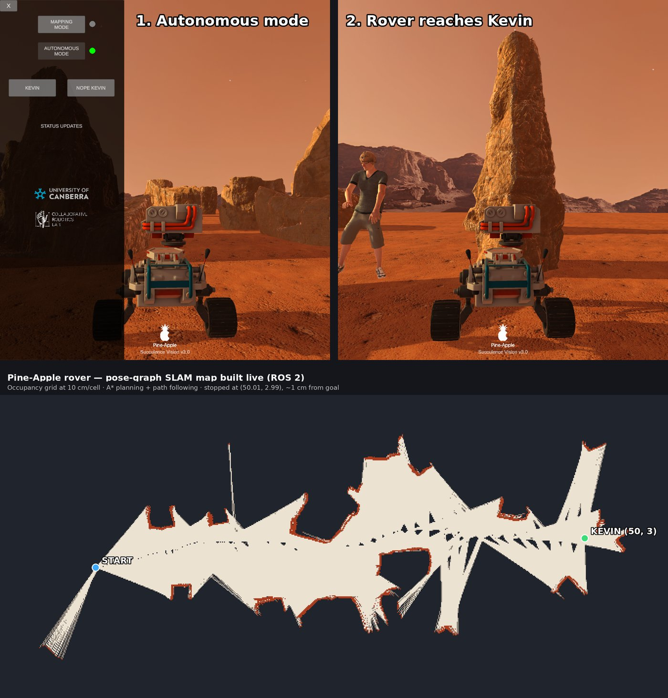
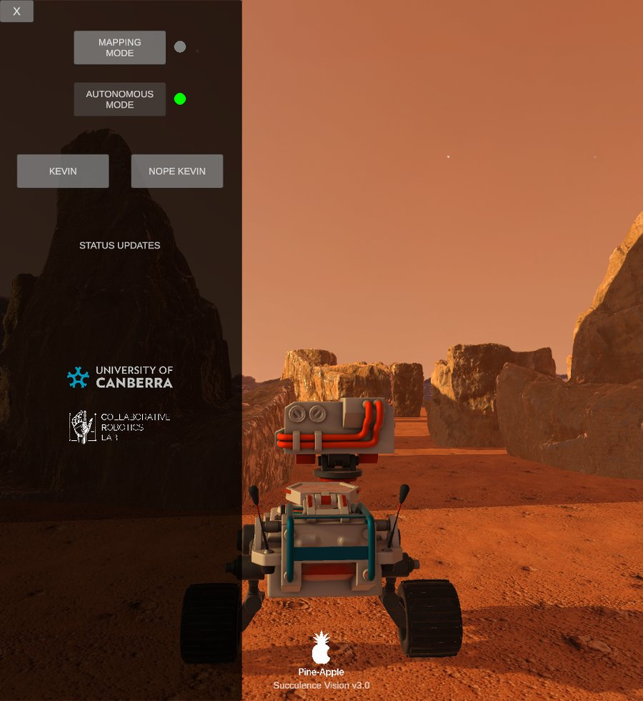
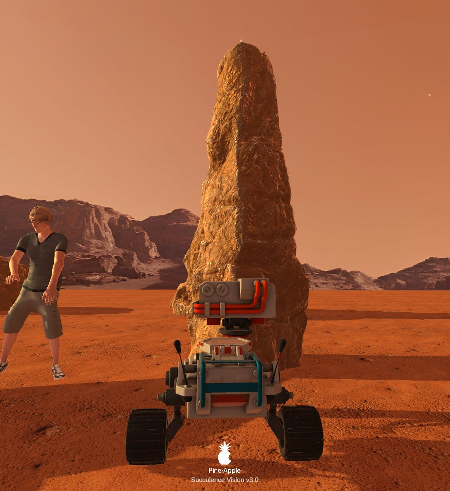
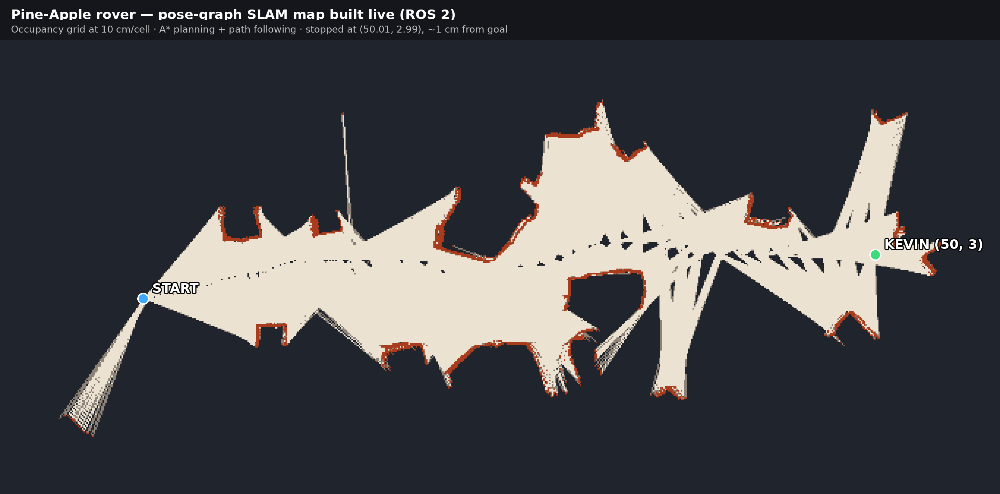
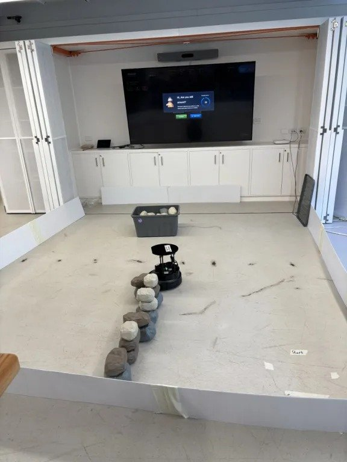
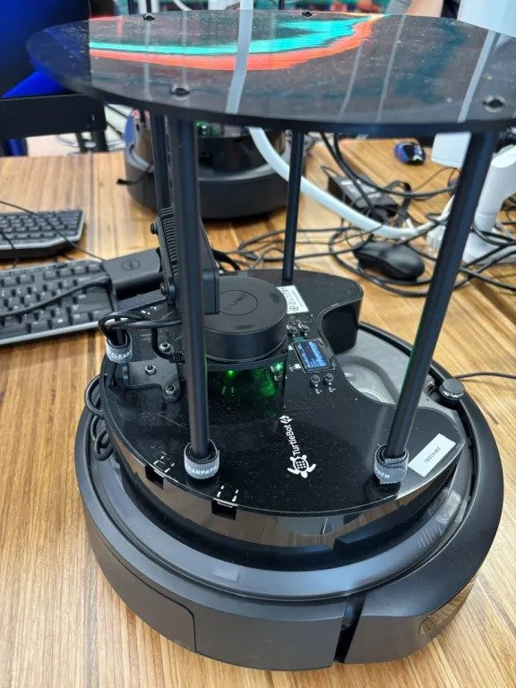
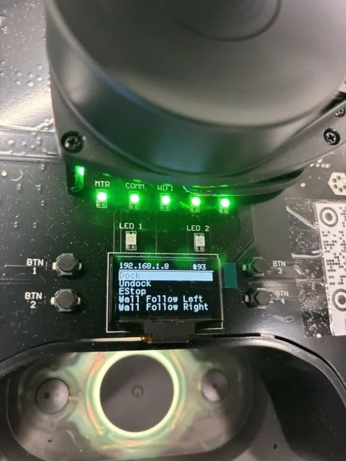
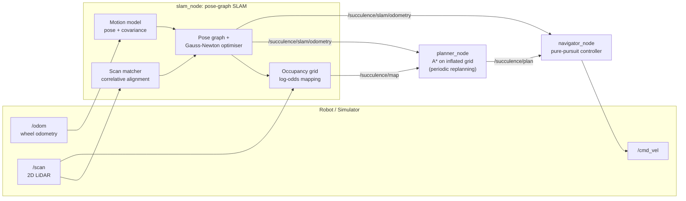

# Operation Find Kevin: Autonomous SLAM and Navigation Rover

[](https://docs.ros.org/en/jazzy/)
[](https://www.python.org/)
[](https://turtlebot.github.io/turtlebot4-user-manual/)
[](#running-in-simulation)

A ROS 2 autonomy stack that lets a TurtleBot explore an unknown arena, build a map with **pose-graph SLAM**, plan a route with **A\***, and drive itself to a target, without hitting obstacles.

The stack was built by **Group 3** for the *Operation Find Kevin* Grand Challenge in **12062 Algorithmic Robotics at the University of Canberra (2026)**. We ran the same package in a Unity Mars simulation and on a physical **TurtleBot 4** in the lab arena.

<p align="center">
  
</p>

---

## Contents

- [The mission](#the-mission)
- [Results](#results)
- [How it works](#how-it-works)
- [Repository layout](#repository-layout)
- [Getting started](#getting-started)
- [Running in simulation](#running-in-simulation)
- [Running on a physical TurtleBot 4](#running-on-a-physical-turtlebot-4)
- [Simulation vs. physical tuning](#simulation-vs-physical-tuning)
- [ROS 2 interface](#ros-2-interface)
- [Debugging](#debugging)
- [Team and credits](#team-and-credits)

---

## The mission

Kevin, an astronaut stranded on Mars, needs rescuing. The rover (nicknamed *Succulence*, branded "Pine-Apple" in the simulator) must, with no human input:

1. **Explore** an arena whose layout it has never seen.
2. **Map** it in real time with pose-graph SLAM, shown live in RViz2.
3. **Plan** a path to Kevin's known coordinates with A\*.
4. **Navigate** along that path, replanning as the map grows, without touching any rocks.
5. **Stop** as close to Kevin as possible.

At the physical challenge, teams had 5 minutes to boot the robot and launch their nodes and a 10-minute window for attempts. Runs were scored on how close the robot stopped to Kevin: within 5 cm, 5–10 cm, 10–30 cm, 30–50 cm, or beyond 50 cm.

## Results

### Simulation (Unity Mars)

In a re-run of the simulation in November 2026, the rover mapped its way about **50 m** across the arena and stopped at **(50.01, 2.99)** against a goal of **(50, 3)**, about **1 cm** away.

| Autonomous mode at start | Rover reaches Kevin |
|:---:|:---:|
|  |  |

**The SLAM map built during that run.** It is rendered directly from the `/succulence/map` occupancy grid: light cells are free space and red cells are obstacles seen by the LiDAR.

<p align="center">
  
</p>

### Physical TurtleBot 4

The same nodes ran on a TurtleBot 4 (an iRobot Create 3 base with an RPLidar) in the University of Canberra robotics lab, in an arena of rock stacks the robot had never seen before.

| Robot in the arena | Hardware | Status display |
|:---:|:---:|:---:|
|  |  |  |

## How it works

The system is a continuous **sense → map → plan → act** loop:



| Component | What it does | Source |
|---|---|---|
| **Motion model** | Adds uncertainty (covariance) to raw wheel odometry using an α-parameter odometry noise model, so the SLAM back-end knows how far to trust each step. | [`motion_model.py`](succulence_rover_ros/motion_model.py) |
| **Occupancy grid** | Bayesian log-odds mapping with Bresenham ray tracing: free space along each beam, an obstacle at its end. | [`occupancy_grid_mapper.py`](succulence_rover_ros/occupancy_grid_mapper.py) |
| **Scan matcher** | Correlation-based alignment of consecutive LiDAR scans over a search window of x, y and θ, which corrects odometry drift. | [`scan_matcher.py`](succulence_rover_ros/scan_matcher.py) |
| **Pose-graph SLAM** | Adds keyframes as nodes and odometry and scan-match constraints as edges, optimises all poses with Gauss-Newton, and rebuilds a corrected map. | [`slam_node.py`](succulence_rover_ros/slam_node.py), [`pose_graph.py`](succulence_rover_ros/pose_graph.py), [`graph_optimizer.py`](succulence_rover_ros/graph_optimizer.py) |
| **A\* planner** | 8-connected A\* with an octile heuristic on an inflated copy of the SLAM grid. Unknown cells count as free (optimistic planning), and the planner replans on a timer as the map grows. | [`astar.py`](succulence_rover_ros/astar.py), [`planner_node.py`](succulence_rover_ros/planner_node.py) |
| **Navigator** | Pure pursuit: steers toward a lookahead point on the path, slows down near the goal, and publishes zero velocity when the plan is stale or the goal is reached. | [`path_follower.py`](succulence_rover_ros/path_follower.py), [`navigator_node.py`](succulence_rover_ros/navigator_node.py) |
| **SE(2) utilities** | Pose composition, inversion, Jacobians and covariance propagation. | [`utils.py`](succulence_rover_ros/utils.py) |

For a week-by-week walkthrough of the architecture, see [`docs/SYSTEMS_OVERVIEW.md`](docs/SYSTEMS_OVERVIEW.md).

## Repository layout

```text
operation-find-kevin/
├── succulence_rover_ros/      # Python package: SLAM, planning and navigation nodes
├── launch/                    # Launch files for simulation and the physical robot
│   ├── mission_sim.launch.py          # Full mission: SLAM + A* + navigator (simulation)
│   ├── mission_physical.launch.py     # Full mission on the TurtleBot 4
│   ├── slam_sim.launch.py / slam_physical.launch.py
│   └── dead_reckoning_sim.launch.py / dead_reckoning_physical.launch.py
├── config/
│   ├── params_sim.yaml                # Tuned parameters for the Unity Mars simulation
│   ├── params_physical.yaml           # Tuned parameters for the TurtleBot 4 arena
│   └── *.rviz                         # RViz2 layouts
├── docs/
│   ├── SYSTEMS_OVERVIEW.md            # Architecture reference (course material)
│   └── media/                         # Images used in this README
├── package.xml
└── setup.py
```

## Getting started

### Requirements

- Ubuntu 24.04 with **ROS 2 Jazzy**
- Python 3 with `numpy` and `scipy`
- For simulation: Docker and the course's Unity Mars simulation containers ([CollaborativeRoboticsLab](https://github.com/CollaborativeRoboticsLab))
- For the physical robot: a TurtleBot 4 (iRobot Create 3 + RPLidar) on the same network

### Build

```bash
mkdir -p ~/succulence_ws/src && cd ~/succulence_ws/src
git clone https://github.com/Mac382005/operation-find-kevin.git
cd ~/succulence_ws
rosdep install --from-paths src --ignore-src -y
colcon build --packages-select succulence_rover_ros --symlink-install
source install/setup.bash
```

## Running in simulation

**1. Start the Unity Mars simulation** (from the course's `algorithmic-robots-world` repository):

```bash
cd ~/algorithmic-robots-world
xhost +local:root
docker compose -f compose-simulation.yaml up
```

In the simulator window, switch the rover to **Autonomous mode**. Keep the simulator window focused or visible; Unity can pause rendering and sensor output when its window is in the background.

**2. Launch the mission** (SLAM + A\* planner + navigator):

```bash
ros2 launch succulence_rover_ros mission_sim.launch.py
```

**3. Open RViz2:**

```bash
rviz2 -d ~/succulence_ws/src/operation-find-kevin/config/succulance_slam.rviz
```

The rover builds the map, publishes a path on `/succulence/plan`, and drives to the goal set in `config/params_sim.yaml` (`planner.goal`).

## Running on a physical TurtleBot 4

**1.** Stop any simulation containers so there are no duplicate `/scan` or `/odom` publishers:

```bash
cd ~/algorithmic-robots-world && docker compose -f compose-simulation.yaml down
```

**2.** Connect to the robot's network and check that its drivers are publishing `/scan` and `/odom`.

**3.** Launch the full mission:

```bash
ros2 launch succulence_rover_ros mission_physical.launch.py
```

The launch file first calls the Create 3 `/reset_pose` service so odometry starts at zero. Only after that call returns does it start the static transforms, SLAM, planner and navigator together, so no node ever reads stale odometry.

To run mapping only, without driving to a goal:

```bash
ros2 launch succulence_rover_ros slam_physical.launch.py
```

**4.** Visualise:

```bash
rviz2 -d ~/succulence_ws/src/operation-find-kevin/config/succulance_slam_physical.rviz
```

Set Kevin's coordinates for the arena in `config/params_physical.yaml` under `planner.goal`.

## Simulation vs. physical tuning

The algorithms are identical in both modes; only the parameters differ. The physical arena is small, cluttered and indoors, so we tuned for precision over speed:

| Parameter | Simulation | Physical | Why |
|---|---|---|---|
| SLAM map resolution | 10 cm | **5 cm** | Finer cells for closely packed rock stacks |
| SLAM map size | 125 × 87.5 m | **7.5 × 7.5 m** | Matches the lab arena |
| LiDAR max range used | 12 m | **3 m** | Ignores long, noisy returns indoors |
| LiDAR yaw offset | 0 | **90° (1.570 rad)** | RPLidar mounting orientation on the TurtleBot 4 |
| Replanning period | 1.0 s | **0.2 s** | Reacts faster as new obstacles appear |
| Obstacle inflation | 10 cells | **1.87 cells** | Lets the robot fit through narrow gaps at 5 cm resolution |
| Pure-pursuit lookahead | 1.5 m | **0.7 m** | Follows the A\* path more tightly and cuts fewer corners |
| Max linear speed | 0.25 m/s | **0.22 m/s** | Gives SLAM and the controller more time to react |
| Goal tolerance | 0.05 m | **0.2 m** | Accounts for real-world odometry and LiDAR noise |
| Velocity topic | `/cmd_vel` | `/cmd_vel_unstamped` | TurtleBot 4 driver interface |

All values are commented in [`params_sim.yaml`](config/params_sim.yaml) and [`params_physical.yaml`](config/params_physical.yaml).

## ROS 2 interface

**Nodes**

| Node | Role |
|---|---|
| `/slam_node` | Builds the SLAM map and corrected trajectory |
| `/planner_node` | Runs A\* on the SLAM occupancy grid |
| `/navigator_node` | Follows the planned path and publishes velocity commands |
| `/map_to_odom_publisher` | Static transform `map → odom` |
| `/base_to_lidar_publisher` | Static transform `base_link → lidar` |

**Topics** (simulation names shown; the physical robot uses `/odom`, `/scan` and `/cmd_vel_unstamped`)

| Topic | Type | Purpose |
|---|---|---|
| `/succulence/odom` | `nav_msgs/Odometry` | Raw wheel odometry |
| `/succulence/scan` | `sensor_msgs/LaserScan` | LiDAR scans |
| `/succulence/map` | `nav_msgs/OccupancyGrid` | SLAM occupancy grid |
| `/succulence/slam/odometry` | `nav_msgs/Odometry` | SLAM-corrected pose |
| `/succulence/slam/path` | `nav_msgs/Path` | Optimised trajectory for RViz2 |
| `/succulence/plan` | `nav_msgs/Path` | A\* path to the goal |
| `/succulence/plan/inflated` | `nav_msgs/OccupancyGrid` | Inflated planning grid |
| `/succulence/plan/reachable` | `nav_msgs/OccupancyGrid` | Cells reachable from the robot |
| `/cmd_vel` | `geometry_msgs/Twist` | Velocity command to the rover |

## Debugging

```bash
ros2 node list                              # all nodes running?
ros2 topic list -t                          # topics and message types
ros2 topic hz /succulence/scan              # is the LiDAR publishing?
ros2 topic echo /succulence/plan --once     # did the planner find a path?
ros2 topic echo /cmd_vel                    # is the navigator commanding motion?
```

**No map appears in RViz2:** first check that `/succulence/scan` and `/succulence/odom` are publishing (`ros2 topic hz`). In simulation, the most common cause is that the Unity window lost focus, or that the rover is not in Autonomous mode.

## Team and credits

**Group 3, 12062 Algorithmic Robotics, University of Canberra (2026)**

- Hoang Nhat Minh Mac
- Nima
- Bishaw
- Joe

**Our work:** we implemented the lab components that build up the SLAM front-end: the odometry motion model with covariance, the occupancy-grid coordinate transforms and beam ray tracing, and the correlative scan matcher. We then integrated the full mission pipeline and tuned it separately for the Unity Mars simulation and the physical TurtleBot 4 (`config/params_*.yaml`, RViz2 layouts).

**Course-provided components:** the unit's teaching team supplied the package scaffold, the pose-graph data structure and Gauss-Newton optimiser, the reference SLAM node, the A\* planner and pure-pursuit navigator, the launch files, and the architecture guide in `docs/SYSTEMS_OVERVIEW.md`. The simulation environment and TurtleBot 4 containers come from the University of Canberra [Collaborative Robotics Lab](https://github.com/CollaborativeRoboticsLab).

The package metadata (`package.xml`, `setup.py`) lists the unit's teaching staff as maintainers and declares an MIT license.
